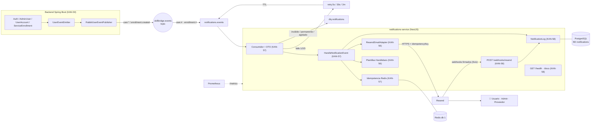

# Épica KAN-49: Microservicio de notificaciones por email (NestJS + Resend)

> **Jira:** [KAN-49](https://skillbridgec3.atlassian.net/browse/KAN-49) · **Fecha objetivo:** hoy, 2026-11-11
> **Equipo:** Dylan Suarez (líder) · Kevin Mercado · Leonardo Ayala
> **Regla del equipo:** nadie (ni personas ni IA) hace merge directo a `develop`/`main`. Todo pasa por PR.

## Reparto (según Jira)

| Historia | Responsable | Qué | Guía |
|---|---|---|---|
| **KAN-59 · HU-NOT00** | Dylan | El backend Java publica los eventos (cuenta + reserva) y se corrigen las fallas de seguridad de los estados de cuenta | [GUIA-DYLAN-HU-NOT00-JAVA.md](./GUIA-DYLAN-HU-NOT00-JAVA.md) |
| **KAN-56 · HU-NOT01** | Dylan | Scaffold NestJS (**base compartida**), `ResendModule`, motor de plantillas Handlebars, Docker y compose | [GUIA-DYLAN-HU-NOT01-KAN-56.md](./GUIA-DYLAN-HU-NOT01-KAN-56.md) |
| **KAN-57 · HU-NOT02** | Kevin | Consumidor RabbitMQ, idempotencia en Redis, reintentos exponenciales y `dlq.notifications`, validación con DTO | [GUIA-KEVIN-HU-NOT02-KAN-57.md](./GUIA-KEVIN-HU-NOT02-KAN-57.md) |
| **KAN-58 · HU-NOT03** | Leonardo | Webhooks de Resend (Svix), `NotificationLog` en PostgreSQL, `/health` con Terminus, Swagger, Prometheus y CI | [GUIA-LEONARDO-HU-NOT03-KAN-58.md](./GUIA-LEONARDO-HU-NOT03-KAN-58.md) |

Documentos comunes:
- [CONTRACT.md](./CONTRACT.md) + [`contract/`](./contract): contrato de eventos (fuente de verdad) y los 6 ejemplos JSON.
- [CONFIGURACION-DOMINIO-Y-SECRETOS.md](./CONFIGURACION-DOMINIO-Y-SECRETOS.md): Hostinger, DNS, Resend, API keys, webhooks y variables por capa.
- [JIRA.md](./JIRA.md): conexión con Jira y estado de las historias.
- [ADR 0005](../adr/0005-notification-microservice-nestjs-resend.md): decisiones de arquitectura.

## 1. Alcance acordado

- **Eventos que generan correo:**
  - **cuenta:** registro, creación por un admin, activación/desactivación, cambio de rol y eliminación;
  - **reserva:** `enrollment.created`, que confirma al cliente y avisa al proveedor.
- **Fuera de esta iteración:** el **recordatorio de sesión en vivo** (CA 1.3 de KAN-56). Necesita una tarea programada nueva en Java que publique, por ejemplo, `meeting.reminder` 1 h antes de cada reunión `PROGRAMADA`. Queda anotado en el backlog y en el comentario de KAN-56.
- **Seguridad (aprobado):**
  - sólo un ADMIN o el propio usuario pueden cambiar el estado o eliminar una cuenta (403);
  - el ADMIN no se puede desactivar;
  - el login de una cuenta INACTIVE se rechaza.
- **`MAIL_REDIRECT_TO` (aprobado):** en desarrollo, todos los correos van a una sola bandeja.

## 2. Arquitectura



**Claves del diseño:**
- **Desacople:** si el microservicio o Resend fallan, el backend sigue funcionando y los mensajes esperan en la cola.
- **Hexagonal en ambos lados:** puertos y adaptadores, y cada persona trabaja en **su** módulo de Nest (`app.module.ts` no se toca después de la base).
- **Resiliencia:** 3 reintentos exponenciales (5 s, 30 s, 2 min) y DLQ con el motivo.
- **Sin duplicados:** idempotencia por correo en Redis (7 días) + `idempotencyKey` de Resend (24 h).
- **Trazabilidad:** `notification_log` en una **base de datos propia** (`notifications`), actualizada con los webhooks firmados.
- **Sin secretos en el frontend ni en git.** El frontend no cambia. El backend no necesita migraciones nuevas.

## 3. Cronograma de hoy

| Bloque | Dylan | Kevin | Leonardo |
|---|---|---|---|
| **0 (0:00-0:45)** | **KAN-56 Bloque 0: base del microservicio → PR.** Comprar el dominio en Hostinger y empezar el DNS. | Leer el contrato y la guía, revisar RabbitMQ/Redis en compose | Leer el contrato y la guía. Crear la cuenta de `cloudflared`/`ngrok` |
| **1 (0:45-3:00)** | KAN-59 (Java), Pasos 1-10B | KAN-57, Pasos 1-5 | KAN-58 Bloque 1, Pasos 1-5 |
| ☕ **Sync (3:00)** | 10 min: cada uno muestra lo suyo. ¿Cambió el contrato? | | |
| **2 (3:15-5:30)** | KAN-59, Pasos 11-15 (pruebas y seguridad) → PR. KAN-56 Bloque 1 (Resend, plantillas, Docker) | KAN-57, Pasos 6-11 → PR | Al mergearse lo de Kevin: KAN-58 Bloque 2 (health, Swagger, CI) → PR |
| **3 (5:30-6:30)** | **Los 3:** integrar en `feature/notificaciones` y correr el checklist §6 | | |
| **Cierre** | PR `feature/notificaciones` → `develop`, `MEMORIA.md` y mover las historias en Jira | | |

> ⚠️ **Carga de Dylan:** tienes 2 historias (≈ 8 h en total). Si el tiempo no alcanza, lo primero que se puede pasar a otra persona es KAN-56, Paso 11 (Docker/compose), que es independiente.

**Dependencias:**
- Kevin y Leonardo necesitan la **base** de Dylan (Bloque 0). Es lo primero del día.
- El Bloque 2 de Leonardo (`/health`) necesita el `MessagingModule` de Kevin.
- Nadie necesita el backend Java para probar: los fixtures del contrato se publican a mano desde la UI de RabbitMQ.

## 4. Ramas y PRs

```
develop
 └── feature/notificaciones                   (integración: la crea Dylan)
      ├── feature/notificaciones-nest-base        (Dylan, KAN-56 Bloque 0)
      ├── feature/notificaciones-java             (Dylan, KAN-59)
      ├── feature/notificaciones-resend-templates (Dylan, KAN-56 Bloque 1)
      ├── feature/notificaciones-consumer         (Kevin, KAN-57)
      ├── feature/notificaciones-webhooks-audit   (Leonardo, KAN-58 parte 1)
      └── feature/notificaciones-health-ops       (Leonardo, KAN-58 parte 2)
```

- Los PR hacia `feature/notificaciones` se auto-mergean cuando el CI pasa (job `auto-merge-feature-pr`). Después, `promote.yml` abre solo el PR hacia `develop`.
- Commits: Conventional Commits en español, con la clave de Jira: `feat(notificaciones): … (KAN-57)`.
- Antes de cada commit: `git status`. **Nunca** `.env`.

```bash
git fetch origin && git merge origin/feature/notificaciones   # traer lo de los demás
gh pr status && gh pr checks                                  # estado del PR y del CI
make up && make logs-notifications                            # stack completo y logs
```

## 5. Definition of Done de la épica

- [ ] Los 6 tipos de evento generan los correos de la tabla del [contrato](./CONTRACT.md#3-tipos-de-evento).
- [ ] Los correos salen del dominio verificado (o de `onboarding@resend.dev` si el DNS sigue propagando, lo cual queda documentado).
- [ ] Reintentos exponenciales, DLQ e idempotencia comprobados.
- [ ] `notification_log` refleja `sent`, `delivered` y `bounced` vía webhooks firmados.
- [ ] `/health` en verde con RabbitMQ, Redis, PostgreSQL y Resend; `/docs` publicado.
- [ ] Seguridad de cuentas corregida (KAN-59, Paso 13).
- [ ] `mvn -B clean verify` y `npm test` en verde, con el CI incluido.
- [ ] Ningún secreto en git ni en el frontend.
- [ ] `MEMORIA.md` y Jira actualizados.

## 6. Checklist de integración E2E (los 3 juntos)

```bash
git checkout feature/notificaciones && git pull
make db-notifications        # una vez por máquina (crea la BD "notifications")
make up && make ps           # backend, rabbitmq, redis, postgres y notifications en (healthy)
```

| # | Acción | Resultado esperado |
|---|---|---|
| 1 | UI de RabbitMQ (`localhost:15672`) | Existen `skillbridge.events`, `notifications.events`, las 3 colas `retry.*` y `dlq.notifications` |
| 2 | Registrarse en el frontend (`localhost:8088`) | Correo de bienvenida + aviso al admin, y 2 filas `sent` en `notification_log` |
| 3 | Inscribirse en un servicio | Confirmación de reserva al cliente + aviso al proveedor |
| 4 | Admin cambia el rol de un usuario a PROVIDER | Correo "Tu rol … cambió a Proveedor" |
| 5 | `PATCH /api/users/{id}/status` `{"active":false}` sobre la **propia** cuenta | Correo de desactivación + aviso al admin; después, el login responde 401 |
| 5b | El mismo `PATCH` sobre la cuenta de **otro** usuario (con sesión de CUSTOMER) | **403**, sin correo |
| 6 | Admin elimina un usuario | Correo de cuenta eliminada |
| 7 | `docker compose stop notifications`, registrarse y luego `docker compose start notifications` | El correo llega al volver |
| 8 | Publicar dos veces el mismo JSON (mismo `eventId`) | Un solo correo (log: "Re-entrega ignorada") |
| 9 | `RESEND_API_KEY=re_invalida` + reiniciar + registrarse | El mensaje termina en `dlq.notifications` con `x-failure-reason`. El registro **sí** funciona |
| 10 | Con túnel + webhook configurado | `notification_log` pasa de `sent` a `delivered`. Con `bounced@resend.dev` queda `bounced` |
| 11 | `curl localhost:3100/health`, `localhost:3100/docs` | 4 componentes `up`; Swagger visible |
| 12 | `make observability` → Grafana "SkillBridge - Notificaciones" | Las gráficas muestran datos |

## 7. Riesgos

| Riesgo | Mitigación |
|---|---|
| El DNS no propaga hoy | Plan B: `onboarding@resend.dev` + `MAIL_REDIRECT_TO` |
| Versiones ESM rompen Jest | Versiones fijadas y verificadas (KAN-56, Paso 1) |
| Correos a direcciones *seed* ajenas (`admin@skillbridge.com`) | `MAIL_REDIRECT_TO` en desarrollo |
| RabbitMQ caído al publicar | El backend no falla (sólo un WARN). Mejora futura: *Transactional Outbox* |
| Límite del plan gratis de Resend (100/día, ~2 req/s) | `prefetch` de 5, reintentos ante 429, `EMAIL_DRIVER=log` en desarrollo y CI |
| Carga de Dylan (2 historias) | Base primero; si el tiempo no alcanza, delegar KAN-56 Paso 11 |
| La URL del túnel cambia | Actualizarla en Resend → Webhooks; en producción usar el dominio real |

## 8. Backlog (fuera de esta iteración)

- **Recordatorio de sesión en vivo** (CA 1.3 de KAN-56): evento `meeting.reminder` desde `MeetingStatusJob` + plantilla.
- Correos de cancelación o retiro de inscripción, cambios de estado de servicios y reuniones.
- *Transactional Outbox* en el backend.
- Botón para activar o desactivar usuarios en el panel admin de Angular.
- Preferencias de notificación por usuario (opt-out).
