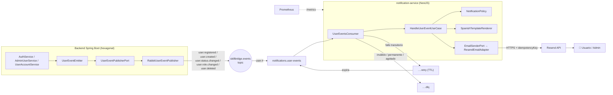

# Épica: Notificaciones por correo (NestJS + Resend + RabbitMQ)

> **Fecha objetivo:** hoy, 2026-11-11 · **Equipo:** Dylan (A, líder), Persona B, Persona C
> **Regla del equipo:** nadie (ni personas ni IA) hace merge directo a `develop`/`main`. Todo pasa por PR.

## Índice de documentos

| Documento | Para quién | Contenido |
|---|---|---|
| **PLAN.md** (este) | Todos | Visión, arquitectura, cronograma, reparto e integración |
| [CONTRACT.md](./CONTRACT.md) + [`contract/`](./contract) | Todos | Contrato de eventos v1 (fuente de verdad) y ejemplos JSON |
| [CONFIGURACION-DOMINIO-Y-SECRETOS.md](./CONFIGURACION-DOMINIO-Y-SECRETOS.md) | Dylan + C | Hostinger, DNS, Resend, API keys y variables por capa |
| [GUIA-PERSONA-A-JAVA.md](./GUIA-PERSONA-A-JAVA.md) | Dylan | Productor de eventos en Spring Boot |
| [GUIA-PERSONA-B-NEST-CORE.md](./GUIA-PERSONA-B-NEST-CORE.md) | Persona B | Núcleo NestJS: RabbitMQ, política, reintentos, métricas |
| [GUIA-PERSONA-C-RESEND-OPS.md](./GUIA-PERSONA-C-RESEND-OPS.md) | Persona C | Resend, plantillas, Docker, CI, Prometheus |
| [JIRA.md](./JIRA.md) | Dylan | Conectar Jira y desglose de la épica |
| [ADR 0005](../adr/0005-notification-microservice-nestjs-resend.md) | Todos | Decisiones de arquitectura y alternativas descartadas |

## 1. Objetivo

Cuando cambia el estado de la cuenta de un usuario (registro, creación por un admin, activación/desactivación, cambio de rol, eliminación), el usuario, y cuando corresponde el administrador, **recibe un correo**. Esto lo hace un **microservicio NestJS nuevo** que envía con **Resend**, sin acoplar el backend Java al proveedor de correo.

## 2. Arquitectura



**Claves del diseño:**
- **Desacople:** si el microservicio o Resend fallan, el backend sigue funcionando y los mensajes esperan en la cola.
- **Hexagonal en ambos lados:** puertos y adaptadores. Cambiar Resend por otro proveedor sólo toca un adaptador.
- **Resiliencia:** reintentos con espera (3 por defecto) y DLQ con el motivo del fallo.
- **Idempotencia:** `eventId` + `idempotencyKey` de Resend, así no se envían correos duplicados.
- **Sin secretos en el frontend ni en git.** El frontend no cambia.
- **Sin migraciones:** v1 no modifica el esquema de BD.

## 3. Cronograma de hoy

| Bloque | Hora sugerida | A: Dylan (Java) | B (Nest core) | C (Resend/ops) |
|---|---|---|---|---|
| **0: Kickoff** | 0:00–0:45 | Leer el contrato juntos (15 min). Crear la rama `feature/notificaciones`. **Comprar el dominio en Hostinger.** | Scaffold y base compartida (Guía B, Pasos 0-9) → push | Cuenta de Resend, agregar el dominio, **DNS en Hostinger** (propaga en paralelo) |
| **1** | 0:45–2:45 | Guía A, Pasos 1-6 | Guía B, Pasos 10-13 | Guía C, Pasos 1-3 (Resend + plantillas) |
| ☕ **Sync 1** | 2:45–3:00 | Cada uno muestra lo suyo (5 min/persona). ¿Cambió algo del contrato? | | |
| **2** | 3:00–5:00 | Guía A, Pasos 7-12 | Guía B, Pasos 14-16 | Guía C, Pasos 4-7 (Docker, compose, Prometheus, CI) |
| **3: Integración** | 5:00–6:00 | **Los 3 juntos:** mergear los PR en `feature/notificaciones`, `make up` y checklist §6 | | |
| **Cierre** | 6:00–6:30 | PR `feature/notificaciones` → `develop`, `MEMORIA.md`, actualizar Jira | | |

**Dependencias (qué bloquea a qué):**
- C necesita la **base de B** (Bloque 0) para empezar el Paso 1. Mientras tanto avanza con el DNS.
- B y C **no** necesitan a A: prueban publicando los fixtures del contrato a mano.
- A **no** necesita a B ni a C: prueba con la UI de RabbitMQ.
- La **única** dependencia dura de todos es el **contrato**. Si alguien quiere cambiarlo, avisa en el grupo **antes**.

## 4. Ramas y flujo de PRs

```
develop
 └── feature/notificaciones                (integración: la crea Dylan)
      ├── feature/notificaciones-java        (A)
      ├── feature/notificaciones-nest-core   (B)
      └── feature/notificaciones-resend-ops  (C)
```

- Cada persona abre un PR **hacia `feature/notificaciones`**. El CI hace auto-merge al pasar (job `auto-merge-feature-pr`).
- Al actualizarse `feature/notificaciones`, `promote.yml` abre solo el PR hacia `develop`. Dylan lo revisa y aprueba en el cierre.
- Commits: Conventional Commits en español (`feat(notificaciones): ...`), como el resto del repo.
- **Nadie hace commit de `.env`.** Antes de cada commit: `git status`.

### Comandos útiles para todos

```bash
# Ver en qué rama estás y qué cambiaste
git status

# Traer lo último de la rama de integración a tu rama (evita conflictos al final)
git fetch origin && git merge origin/feature/notificaciones

# Ver el estado de tu PR y del CI (requiere: gh auth login)
gh pr status
gh pr checks

# Levantar todo el stack / ver logs del microservicio
make up
make logs-notifications
```

## 5. Definition of Done de la épica

- [ ] Los 5 tipos de evento generan los correos de la tabla del [contrato](./CONTRACT.md#3-tipos-de-evento).
- [ ] Los correos llegan desde el dominio verificado (o desde `onboarding@resend.dev` si el DNS sigue propagando, lo cual queda documentado).
- [ ] Reintentos y DLQ funcionan (checklist §6).
- [ ] `mvn -B clean verify` y `npm test` en verde, con el CI incluido.
- [ ] Ningún secreto en git ni en el frontend.
- [ ] Fallas de seguridad corregidas (Guía A, Paso 13): autorización en `PATCH/DELETE /api/users/{id}`, ADMIN no desactivable, login INACTIVE rechazado.
- [ ] `MEMORIA.md` actualizado (una entrada por persona o una del equipo).
- [ ] Jira actualizado.

## 6. Checklist de integración E2E (Bloque 3, los 3 juntos)

```bash
git checkout feature/notificaciones && git pull
cp -n .env.example .env   # sólo si no tienes .env; luego completa las variables de Resend
make up
make ps                   # backend, rabbitmq y notifications en estado (healthy)
```

| # | Acción | Resultado esperado |
|---|---|---|
| 1 | `http://localhost:15672` → Exchanges / Queues | Existen `skillbridge.events`, `notifications.user-events`, `.retry` y `.dlq` |
| 2 | Registrarse desde el frontend (`http://localhost:8088`) | Correo de bienvenida + aviso al admin. En los logs del backend: `Evento publicado: type=user.registered` |
| 3 | Admin → cambiar el rol de un usuario a PROVIDER | Correo "Tu rol en SkillBridge AI cambió a Proveedor" |
| 4 | `PATCH /api/users/{id}/status` con `{"active": false}` sobre la **propia** cuenta | Correo "Tu cuenta fue desactivada" + aviso al admin. Después, el login de esa cuenta responde 401 con "Tu cuenta está desactivada…" |
| 4b | El mismo `PATCH` sobre la cuenta de **otro** usuario, con sesión de CUSTOMER | **403** y ningún correo |
| 5 | Admin → eliminar un usuario | Correo "Tu cuenta fue eliminada" |
| 6 | `docker compose stop notifications`, registrar un usuario y luego `docker compose start notifications` | El correo llega al volver: el mensaje esperó en la cola |
| 7 | Poner `RESEND_API_KEY=re_invalida`, reiniciar y registrar | El mensaje termina en `.dlq` con `x-failure-reason`. El registro del usuario **sí** funciona |
| 8 | Publicar a mano el mismo JSON dos veces (mismo `eventId`) | Un solo correo |
| 9 | `make observability` → Grafana "SkillBridge - Notificaciones" | Las gráficas muestran eventos procesados |

Para el paso 4, con un token de usuario (cookie de sesión), ejemplo con curl:

```bash
# 1) Login: guarda la cookie de sesión en /tmp/sb-cookie
curl -s -c /tmp/sb-cookie -X POST http://localhost:8081/api/auth/login \
  -H 'Content-Type: application/json' \
  -d '{"email":"<correo-usuario>","password":"<clave>"}'

# 2) Desactivar la propia cuenta (reemplaza <id-usuario>)
curl -s -b /tmp/sb-cookie -X PATCH http://localhost:8081/api/users/<id-usuario>/status \
  -H 'Content-Type: application/json' -d '{"active": false}'
```

> Si el login responde un token en el cuerpo en lugar de una cookie, usa `-H "Authorization: Bearer <token>"` en el segundo comando.

## 7. Riesgos y mitigaciones

| Riesgo | Mitigación |
|---|---|
| El DNS no propaga hoy | Plan B: `onboarding@resend.dev` + `MAIL_REDIRECT_TO` ([configuración §4](./CONFIGURACION-DOMINIO-Y-SECRETOS.md#plan-b-el-dominio-todavía-no-está-verificado)) |
| Versiones ESM de Nest 12 / golevelup ≥7 rompen Jest | Versiones fijadas y verificadas en la Guía B, Paso 1 |
| Correos a direcciones *seed* ajenas (`admin@skillbridge.com`) | `MAIL_REDIRECT_TO` en desarrollo ([configuración §5](./CONFIGURACION-DOMINIO-Y-SECRETOS.md#5-usuarios-de-prueba-con-correos-reales-sólo-tu-bd-local)) |
| RabbitMQ caído cuando el backend publica | El backend no falla (WARN). Mejora futura: *Transactional Outbox* (ADR 0005) |
| Límite del plan gratis de Resend (100/día, ~2 req/s) | `prefetch` de 5, reintentos ante 429 y `EMAIL_DRIVER=log` en desarrollo y CI |
| Conflictos en `package.json` entre B y C | C sólo agrega `resend` y `lint:check`; en caso de conflicto, `npm install` regenera el lock |

## 8. Fuera de alcance (backlog sugerido)

- Notificar los estados de **inscripciones**, **servicios** y **reuniones** (bastaría con agregar routing keys `enrollment.*`, `offering.*` y `meeting.*` al contrato y nuevas plantillas).
- *Transactional Outbox* en el backend (entrega garantizada).
- Historial de correos enviados (BD propia del microservicio).
- Preferencias de notificación por usuario (opt-out).
- Webhooks de Resend (rebotes y quejas) para marcar correos inválidos.
