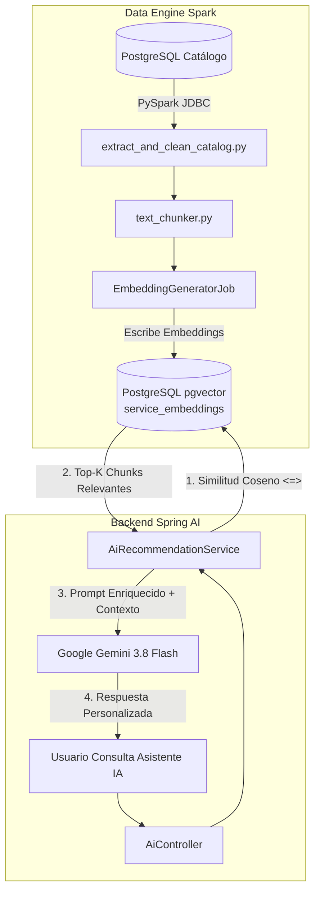

# US-AI-02: Búsqueda Semántica Vectorial con pgvector y ETL PySpark

**Estado:** `[ ] Por hacer`

---

## 1. Descripción y Objetivo de Ingeniería

Optimizar el subsistema de Inteligencia Artificial y Recomendaciones de SkillBridge AI mediante la integración de la extensión **`pgvector`** sobre PostgreSQL 17 y la potenciación del clúster de procesamiento distribuido **Apache Spark (PySpark 3.5.x)**. Permite indexar representaciones vectoriales (embeddings de 768/1536 dimensiones) de los servicios, temarios y prerequisitos, habilitando un motor de **Generación Aumentada por Recuperación (RAG)** de alta precisión para el asistente de IA con Gemini 3.8 Flash.

---

## 2. Arquitectura de la Solución (RAG Vectorial & Spark Pipeline)

1. **Migración Flyway para Base de Datos Vectorial:**
   - Creación de migración `V19__pgvector_extension_and_embeddings.sql` habilitando `CREATE EXTENSION IF NOT EXISTS vector;` y tabla `service_embeddings (id UUID, service_id UUID, chunk_text TEXT, embedding vector(768), created_at TIMESTAMPTZ)`.
   - Creación de índice HNSW (`ivfflat` o `hnsw`) con métrica de distancia coseno (`vector_cosine_ops`) para recuperación de vecinos más cercanos en submilisegundos.
2. **Pipeline de Generación de Embeddings en PySpark:**
   - Script batch en `analytics-service/jobs/generate_vector_embeddings.py` que lee los fragmentos producidos por `text_chunker.py`, genera los vectores utilizando la API de embeddings de Google Gemini o modelo local compatible y realiza carga JDBC particionada en `service_embeddings`.
3. **Capa de Aplicación y Spring AI:**
   - Puerto `VectorSearchPort` con método `List<ServiceChunkMatch> findTopSimilar(float[] queryVector, int topK, double threshold)`.
   - Inyección del contexto más relevante en el system prompt de `AiRecommendationService` para eliminar alucinaciones y fundamentar las respuestas en el catálogo real.

---

## 3. Componentes Técnicos y Referencias de Implementación

- Pipeline ETL de catálogo en PySpark:
  *(Ver `analytics-service/jobs/extract_and_clean_catalog.py` línea 30:75)*.
- Segmentador de texto para IA:
  *(Ver `analytics-service/jobs/text_chunker.py` línea 15:55)*.
- Servicio de recomendaciones con IA:
  *(Ver `backend/src/main/java/com/riwi/skillbridge/application/service/AiRecommendationService.java` línea 25:70)*.
- Controlador de IA en backend:
  *(Ver `backend/src/main/java/com/riwi/skillbridge/infrastructure/adapter/in/rest/AiController.java`)*.

---

## 4. Criterios de Aceptación Técnicos

- **CA-AI-02.1:** Las consultas de búsqueda semántica mediante el operador `<=>` (distancia coseno de pgvector) deben responder en menos de 50ms para un volumen de hasta 10,000 servicios.
- **CA-AI-02.2:** El pipeline de PySpark debe ejecutarse de forma idempotente en el clúster (`spark-master` / `spark-worker`), regenerando únicamente los vectores de servicios modificados según su `updated_at`.
- **CA-AI-02.3:** Si el servicio de embeddings no responde o falla, el sistema debe degradar graciosamente su comportamiento mediante fallback a búsqueda léxica/textual convencional sin lanzar excepciones al usuario.
