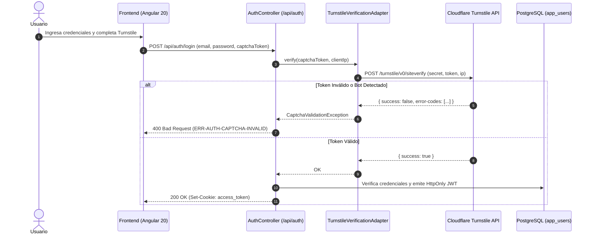

# US-AUTH-04: Protección Anti-Bot con Cloudflare Turnstile en Login y Registro

**Estado:** `[ ] Por hacer`

---

## 1. Descripción y Objetivo de Ingeniería

Implementar un mecanismo de protección contra ataques de fuerza bruta, credential stuffing y bots automatizados en los flujos de inicio de sesión y registro de usuarios utilizando **Cloudflare Turnstile**. La solución debe validar el token emitido por el cliente en el backend de forma síncrona y segura antes de proceder a la autenticación o consulta a la base de datos de usuarios, garantizando máxima privacidad sin interrupciones ni pruebas de interacción molestas (puzzles).

---

## 2. Arquitectura de la Solución (Hexagonal & Seguridad)

1. **Capa Frontend (Angular 20 Standalone):**
   - Integración del widget Cloudflare Turnstile en `LoginComponent`.
   - Captura del token generado y anexado al payload de login (`LoginRequest`) y registro (`RegisterRequest`).
2. **Capa de Aplicación (Backend):**
   - Definición del puerto de salida `CaptchaVerificationPort` con método `boolean verify(String captchaToken, String remoteIp)`.
   - Modificación del caso de uso `AuthUseCase` para anteponer la validación del CAPTCHA a cualquier consulta de persistencia.
3. **Capa de Infraestructura (Backend):**
   - Implementación del adaptador `TurnstileVerificationAdapter` que consume `https://challenges.cloudflare.com/turnstile/v0/siteverify` vía `RestClient` de Spring con timeout estricto de 2.5s.
   - Parámetros `TURNSTILE_SECRET_KEY` y `TURNSTILE_SITE_KEY` gestionados mediante variables de entorno seguras.

---

## 3. Componentes Técnicos y Referencias de Implementación

- Controlador de autenticación:
  *(Ver `backend/src/main/java/com/riwi/skillbridge/infrastructure/adapter/in/rest/AuthController.java` línea 30:80)*.
- DTO de login y registro:
  *(Ver `backend/src/main/java/com/riwi/skillbridge/infrastructure/adapter/in/rest/dto/AuthRequest.java`)*.
- Servicio de autenticación en backend:
  *(Ver `backend/src/main/java/com/riwi/skillbridge/application/service/AuthService.java` línea 25:60)*.
- Componente de autenticación en frontend:
  *(Ver `frontend/src/app/features/login/login.ts` línea 90:114)*.

---

## 4. Criterios de Aceptación Técnicos

- **CA-AUTH-04.1:** Si la petición a `/api/auth/login` o `/api/auth/register` no incluye `captchaToken` o el token es rechazado por Cloudflare, el servidor debe responder con código HTTP `400 Bad Request` y código de error de dominio `ERR-AUTH-CAPTCHA-INVALID` sin ejecutar consultas sobre la tabla `app_users`.
- **CA-AUTH-04.2:** El secreto `TURNSTILE_SECRET_KEY` nunca debe exponerse en el código ni en los bundles generados para el navegador.
- **CA-AUTH-04.3:** En entornos de prueba (`test` profile), el puerto `CaptchaVerificationPort` debe admitir un mock/bypass controlado para permitir suites de pruebas automatizadas MockMvc e integración continua.
