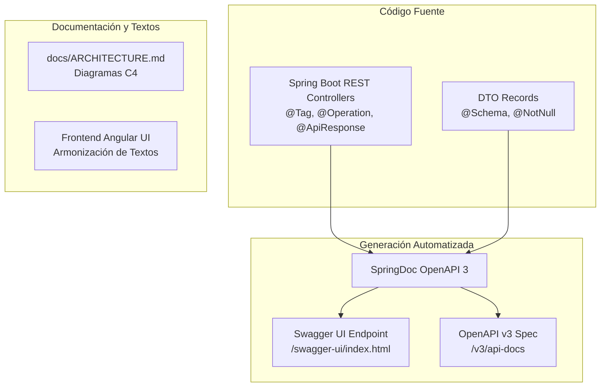

# US-DOCS-04: Centralización Documental OpenAPI 3, Arquitectura C4 y Textos

**Estado:** `[ ] Por hacer`

---

## 1. Descripción y Objetivo de Ingeniería

Elevar la calidad técnica, consistencia y completitud de la documentación de SkillBridge AI. El proyecto requiere centralizar la especificación interactiva de la API REST mediante **OpenAPI 3 / Swagger**, incorporar diagramas de arquitectura formal (C4 Model) y auditar/armonizar los textos y elementos descriptivos de la interfaz de usuario en el frontend.

> [!NOTE] Delimitación con historias existentes:
> Esta historia **no se sobrepone** a `US-DOCS-01` (actualización manual de `API.md` con cookies/CSRF a cargo de `@tsuhikuriislife-lab`), `US-DOCS-02` (unificación del modelo Gemini a cargo de `@leonardo-200224`), ni a `US-DOCS-03` (estandarización de fichas base a cargo de `@deleonguillermo87`). Se enfoca exclusivamente en la automatización viva de contratos con Swagger, modelado C4 y copywriting de interfaz.

---

## 2. Arquitectura de la Solución (Documentación Viva & Modelado)

1. **OpenAPI 3 / Swagger en Spring Boot:**
   - Incorporación de la dependencia `springdoc-openapi-starter-webmvc-ui`.
   - Anotación de controladores REST con `@Tag`, `@Operation` y `@ApiResponse` documentando códigos HTTP exitosos y respuestas de error RFC 7807 (`ERR-xxx`).
   - Configuración de seguridad en Swagger para permitir pruebas locales con cookies y CSRF token sin requerir tokens Bearer obsoletos.
2. **Modelado de Arquitectura (C4 Model):**
   - Incorporación de diagramas de Contexto, Contenedores y Componentes en `docs/ARCHITECTURE.md`.
3. **Revisión Textual de UI:**
   - Auditoría y armonización de copy/textos en Angular para asegurar consistencia en la terminología (ej. "Mentorías", "Servicios", "Inscripciones", "Tutores").

---

## 3. Componentes Técnicos y Referencias de Implementación

- Contrato técnico de endpoints:
  *(Ver `docs/API.md`)*.
- Estado general y arquitectura técnica del sistema:
  *(Ver `STATE.md`)*.
- Configuración de seguridad Spring Security:
  *(Ver `backend/src/main/java/com/riwi/skillbridge/infrastructure/security/SecurityConfiguration.java`)*.
- Archivo de arquitectura del sistema:
  *(Ver `docs/ARCHITECTURE.md`)*.

---

## 4. Criterios de Aceptación Técnicos

- **CA-DOCS-04.1:** La documentación Swagger UI debe ser accesible en `/swagger-ui/index.html` en entornos de desarrollo local, listando el 100% de los endpoints activos con sus schemas de request y response.
- **CA-DOCS-04.2:** El documento `docs/API.md` debe estar alineado con los endpoints reales sin contener discrepancias en nombres de atributos JSON ni esquemas de autenticación.
- **CA-DOCS-04.3:** Todos los textos y etiquetas de la interfaz de usuario deben cumplir con pautas de redacción profesional, sin placeholders temporales ni textos genéricos tipo "Lorem Ipsum".
