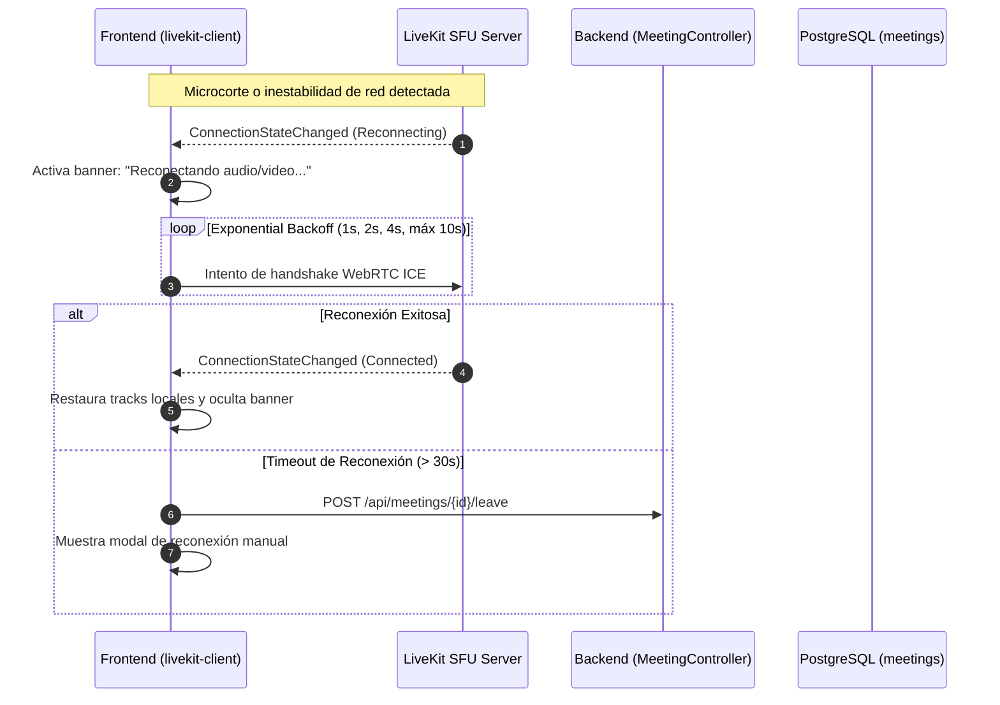

# US-LK-02: Fortalecimiento y Resiliencia de Videoconferencias LiveKit

**Estado:** `[ ] Por hacer`

---

## 1. Descripción y Objetivo de Ingeniería

Robustecer la infraestructura y el cliente WebRTC de videoconferencias en **LiveKit**, garantizando estabilidad y resiliencia ante fluctuaciones de red, reconexión automática transparente con retroceso exponencial, monitoreo de métricas de calidad de conexión en tiempo real para los participantes, control de límites y tiempos de expiración de salas, y verificación criptográfica estricta de webhooks en el backend.

> [!NOTE] Relación con el Backlog:
> `US-29.11` implementó la integración base con LiveKit (tokens y sala elemental) y `US-FE-02` cubre la suite de tests unitarios asignada a `@juanvargasviloria2507-gif`. `US-LK-02` se concentra exclusivamente en la capa de resiliencia avanzada ante inestabilidades de red y endurecimiento operativo.

---

## 2. Arquitectura de la Solución (WebRTC Resiliente & LiveKit SFU)

1. **Cliente Frontend (Angular Signals & LiveKit SDK):**
   - Escucha de eventos de calidad de conexión: `RoomEvent.ConnectionQualityChanged` mapeado a señales reactivas para mostrar indicadores de señal (Excelente, Buena, Pobre) en los avatars de los participantes.
   - Manejo de estados de reconexión: `RoomEvent.Reconnecting` y `RoomEvent.Reconnected` con feedback visual no invasivo (`ToastService`).
   - Política de desconexión limpia ante abandono de pestaña o cierre del navegador (`beforeunload`).
2. **Backend (Seguridad y Ciclo de Vida de Salas):**
   - Incorporación de `emptyTimeout` (cerrar sala automáticamente tras 5 minutos de inactividad) y `maxParticipants` en la creación de salas vía `RoomService` en `LiveKitRestAdapter`.
   - Verificación de la firma HMAC de los webhooks de LiveKit para evitar spoofing de eventos de asistencia o finalización de llamadas.
   - Registro de métricas de duración real y eventos de desconexión en base de datos.

---

## 3. Componentes Técnicos y Referencias de Implementación

- Adaptador de salida LiveKit Twirp y generación de tokens:
  *(Ver `backend/src/main/java/com/riwi/skillbridge/infrastructure/adapter/out/livekit/LiveKitRestAdapter.java` línea 50:112)*.
- Controlador de webhooks de LiveKit:
  *(Ver `backend/src/main/java/com/riwi/skillbridge/infrastructure/adapter/in/rest/LiveKitWebhookController.java` línea 50:90)*.
- Componente de sala de reuniones WebRTC:
  *(Ver `frontend/src/app/features/meeting-room/meeting-room.component.ts` línea 25:95)*.
- Servicio frontend para reuniones:
  *(Ver `frontend/src/app/core/meeting.service.ts` línea 20:50)*.

---

## 4. Criterios de Aceptación Técnicos

- **CA-LK-02.1:** Ante una pérdida temporal de conectividad (pausa de red simulada en navegador), el componente `MeetingRoomComponent` no debe crashear ni recargar la página, sino recuperar automáticamente los tracks locales y remotos una vez restablecida la red.
- **CA-LK-02.2:** La sala debe incluir un indicador visual de calidad de red por cada usuario conectado que refleje los estados `POOR`, `GOOD` o `EXCELLENT` emitidos por el SFU.
- **CA-LK-02.3:** Si un participante abandona la reunión o cierra el navegador, el webhook correspondiente `participant_left` debe registrar la hora exacta de salida en la entidad `MeetingParticipant` dentro de PostgreSQL.
