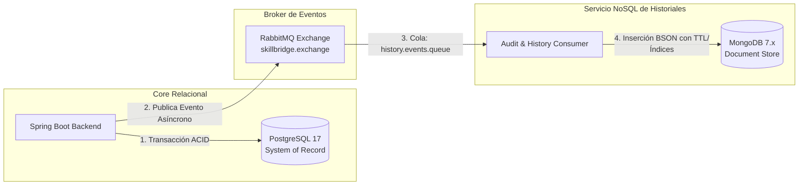

# US-NOSQL-01: Persistencia Políglota de Historiales y Auditoría en MongoDB vía RabbitMQ

**Estado:** `[ ] Por hacer`

---

## 1. Descripción y Objetivo de Ingeniería

Implementar un patrón de **Persistencia Políglota** y **Arquitectura Orientada a Eventos (EDA)** desacoplando el almacenamiento de historiales de inscripciones, logs de auditoría y trazas de reuniones fuera de la base de datos relacional principal (PostgreSQL 17), dirigiéndolos hacia una base de datos documental **MongoDB**. Esta separación previene la saturación y fragmentación de tablas en PostgreSQL, optimiza la escalabilidad de consultas históricas append-only y maximiza el valor formativo de la arquitectura del proyecto.

---

## 2. Arquitectura de la Solución (Persistencia Políglota & EDA)

1. **Broker y Enrutamiento (RabbitMQ):**
   - Configuración del exchange `skillbridge.exchange` (topic) con bind a la cola `history.events.queue` bajo la clave de enrutamiento `history.#`.
   - Implementación de Dead Letter Queue (`history.dlq`) con política de reintentos y retroceso exponencial (exponential backoff).
2. **Servicio Consumidor y Persistencia Documental (MongoDB):**
   - Documento BSON flexible `HistoryEntryDocument` conteniendo: `id`, `entityType` (BOOKING, MEETING, AUTH, AUDIT), `entityId`, `userId`, `payloadSnapshot`, `metadata` (IP, User-Agent, latencia) y `timestamp`.
   - Índices compuestos en MongoDB: `{ userId: 1, timestamp: -1 }` y `{ entityType: 1, timestamp: -1 }` para búsquedas en submilisegundos.
3. **Consulta de Historiales:**
   - Puerto de lectura `HistoryQueryPort` implementado por `MongoHistoryQueryAdapter` para alimentar la vista de auditoría de los usuarios y administradores.

---

## 3. Componentes Técnicos y Referencias de Implementación

- Controlador actual de historiales:
  *(Ver `backend/src/main/java/com/riwi/skillbridge/infrastructure/adapter/in/rest/BookingHistoryController.java` línea 20:60)*.
- Servicio de dominio de historial:
  *(Ver `backend/src/main/java/com/riwi/skillbridge/application/service/BookingHistoryService.java` línea 25:55)*.
- Configuración de RabbitMQ en infraestructura:
  *(Ver `backend/src/main/java/com/riwi/skillbridge/infrastructure/config/RabbitMqConfig.java`)*.
- Modelo de historial relacional legacy:
  *(Ver `backend/src/main/java/com/riwi/skillbridge/domain/model/BookingHistory.java` línea 10:30)*.

---

## 4. Criterios de Aceptación Técnicos

- **CA-NOSQL-01.1:** Las operaciones de negocio en PostgreSQL no deben bloquearse ni esperar la persistencia en MongoDB; la escritura en MongoDB debe ser estrictamente asíncrona mediante RabbitMQ.
- **CA-NOSQL-01.2:** Si MongoDB no está disponible temporalmente, los mensajes deben acumularse en RabbitMQ y procesarse con reintentos sin pérdida de eventos históricos.
- **CA-NOSQL-01.3:** La configuración del contenedor MongoDB debe integrarse limpiamente en `docker-compose.yml` bajo un perfil específico o servicio estándar con volúmenes persistentes.
