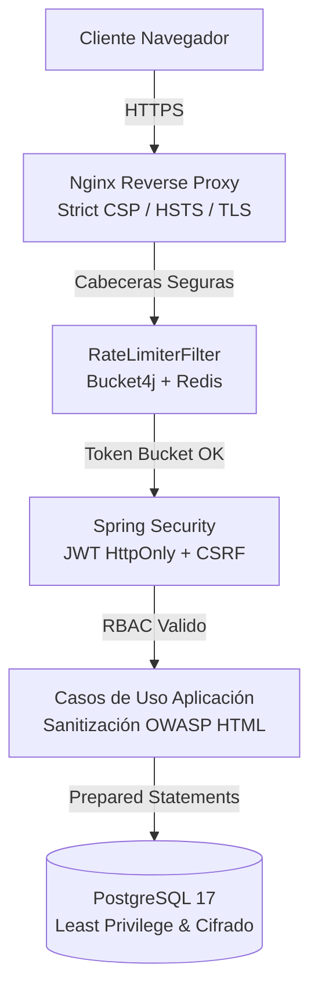

# US-SEC-02: Hardening Integral de Seguridad de Datos y Rate Limiting

**Estado:** `[ ] Por hacer`

---

## 1. Descripción y Objetivo de Ingeniería

Ejecutar un proceso exhaustivo de blindaje y auditoría de seguridad en todas las capas del sistema (Frontend, Backend, Proxy Reverso y Base de Datos) para mitigar vectores de ataque comunes (OWASP Top 10), tales como Cross-Site Scripting (XSS), ataques de denegación de servicio (DoS/DDoS), inyección de dependencias, exposición indebida de secretos e inseguridad en cabeceras HTTP.

---

## 2. Arquitectura de la Solución (Defensa en Profundidad)

1. **Capa Web & Proxy Reverso (Nginx / Spring Security):**
   - Configuración de cabeceras HTTP de seguridad mandatorias:
     - `Content-Security-Policy (CSP)` estricta sin `unsafe-inline` ni `unsafe-eval` injustificados.
     - `X-Content-Type-Options: nosniff`.
     - `X-Frame-Options: DENY` (prevención de Clickjacking).
     - `Strict-Transport-Security (HSTS)` con `max-age=31536000; includeSubDomains`.
     - `Referrer-Policy: strict-origin-when-cross-origin`.
2. **Rate Limiting Distribuido con Redis (Backend):**
   - Implementación de un filtro `RateLimitingFilter` basado en **Bucket4j** respaldado por Redis 8.
   - Políticas de consumo:
     - Endpoints públicos de autenticación (`/api/auth/*`): Límite estricto de 10 peticiones/minuto por IP.
     - Endpoints de IA y generación (`/api/ai/*`): Límite de 20 peticiones/minuto por usuario autenticado.
     - Endpoints generales de API: 120 peticiones/minuto por usuario.
3. **Cero Secretos y Sanitización de Entrada:**
   - Sanitización de strings en entradas de texto rico y descripciones de servicios utilizando librerías validadas (OWASP Java HTML Sanitizer) antes de la persistencia.
   - Auditoría automatizada de exclusión de tokens o claves en respuestas JSON y bundles estáticos del frontend.

---

## 3. Componentes Técnicos y Referencias de Implementación

- Filtro de autenticación JWT y configuración de seguridad:
  *(Ver `backend/src/main/java/com/riwi/skillbridge/infrastructure/security/SecurityConfiguration.java` línea 50:90)*.
- Filtro de tokens JWT:
  *(Ver `backend/src/main/java/com/riwi/skillbridge/infrastructure/security/JwtAuthenticationFilter.java` línea 25:65)*.
- Configuración de Nginx en frontend:
  *(Ver `frontend/nginx.conf`)*.
- Gestión de CORS y cabeceras web:
  *(Ver `backend/src/main/java/com/riwi/skillbridge/infrastructure/config/WebSecurityConfig.java`)*.

---

## 4. Criterios de Aceptación Técnicos

- **CA-SEC-02.1:** Las peticiones que excedan la cuota de Rate Limiting deben ser rechazadas de inmediato con código HTTP `429 Too Many Requests` y cabeceras estándar `Retry-After`.
- **CA-SEC-02.2:** Todas las respuestas HTTP del frontend y de la API deben incluir el conjunto completo de cabeceras de seguridad CSP, HSTS y no-sniff verificado mediante escaneo OWASP ZAP o similar.
- **CA-SEC-02.3:** No debe existir ningún endpoint que permita SQL Injection; todas las consultas dinámicas deben utilizar parámetros tipados en Spring Data JPA / Hibernate.
