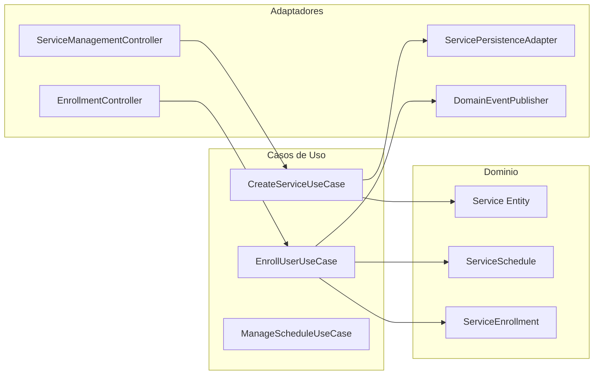

# US-SRV-02: Consolidación y Gestión Integral del Ciclo de Servicios

**Estado:** `[ ] Por hacer`

---

## 1. Descripción y Objetivo de Ingeniería

Consolidar el dominio y la gestión de servicios en SkillBridge AI, unificando la administración de servicios formativos, horarios (`service_schedules`), matriculación (`user_services`) y disponibilidad para tutores y estudiantes. Esta historia resuelve la transición entre las estructuras preliminares (`offerings`) y el esquema relacional formalizado en la migración `V8__services_schema.sql`.

> [!NOTE] Relación con el Backlog:
> `US-10` cubrió la creación y edición básica de ofertas y horarios por parte de proveedores. `US-SRV-02` **no la duplica**, sino que completa el ciclo de vida del estudiante (enrolamiento en `user_services`, validación estricta de cupos restantes y estados `ACTIVE`/`COMPLETED`/`CANCELLED`) e integra la migración al modelo unificado `services`.

---

## 2. Arquitectura de la Solución (Hexagonal & Consistencia de Dominio)

1. **Gestión por Proveedores:**
   - Creación, actualización y desactivación de servicios a través de `ServiceManagementController` (`/api/provider/services`), asegurando aislamiento estricto de propiedad (un tutor solo puede modificar sus propios servicios).
   - Definición de horarios, duración de sesión y frecuencia (`ServiceScheduleController`).
2. **Matriculación de Estudiantes:**
   - Endpoint `POST /api/services/{id}/enroll` para reserva y decremento de cupos disponibles (`remaining_sessions`).
   - Generación del evento `service.enrolled` publicado a RabbitMQ para actualizar el feature store y notificar al tutor.
3. **Frontend:**
   - Actualización de las vistas de creación de ofertas (`CreateOfferingComponent`) y catálogo público para operar contra el contrato unificado de servicios con paginación optimizada.

---

## 3. Componentes Técnicos y Referencias de Implementación

- Controlador de gestión de servicios del proveedor:
  *(Ver `backend/src/main/java/com/riwi/skillbridge/infrastructure/adapter/in/rest/ServiceManagementController.java` línea 20:65)*.
- Controlador de matriculación y participación:
  *(Ver `backend/src/main/java/com/riwi/skillbridge/infrastructure/adapter/in/rest/EnrollmentController.java` línea 25:55)*.
- Esquema de base de datos de servicios:
  *(Ver `backend/src/main/resources/db/migration/V8__services_schema.sql` línea 6:46)*.
- Servicio frontend para gestión de servicios y catálogo:
  *(Ver `frontend/src/app/core/offering.service.ts` línea 38:85)*.

---

## 4. Criterios de Aceptación Técnicos

- **CA-SRV-02.1:** Un proveedor no puede editar, desactivar o alterar horarios de un servicio cuyo `created_by` no coincida con su identidad de usuario autenticado (retorna `403 Forbidden`).
- **CA-SRV-02.2:** La matriculación de un estudiante debe fallar con `422 Unprocessable Entity` (`ERR-SRV-CAPACITY-EXCEEDED`) si la capacidad máxima (`capacity`) del servicio ha sido alcanzada.
- **CA-SRV-02.3:** Todo cambio en el estado de un servicio (`ACTIVE`, `INACTIVE`) debe invalidar automáticamente la clave correspondiente en la caché de Redis (`catalog:public:*`).
