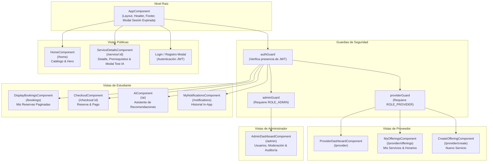
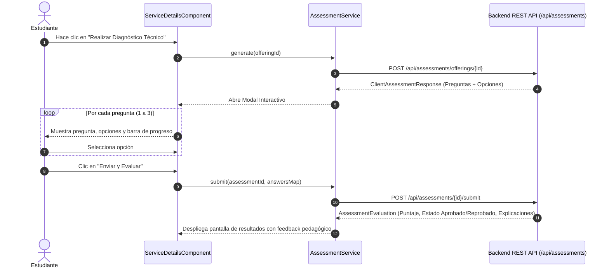

# SkillBridge AI - Frontend SPA

Aplicación de página única (Single Page Application - SPA) para **SkillBridge AI**, construida con **Angular 20 (Standalone Components)**, **TypeScript 5.9**, **RxJS** y maquetación de alta fidelidad sin frameworks CSS pesados.

---

## 1. Stack Tecnológico

| Componente | Tecnología | Versión | Propósito |
|---|---|---|---|
| **Framework** | Angular | 20.3.0 | Arquitectura de componentes Standalone y Reactividad |
| **Lenguaje** | TypeScript | 5.9.2 | Tipado estático y compilación estricta |
| **Gestión Asíncrona**| RxJS | 7.8.2 | Observables, operadores de flujo y comunicación de eventos |
| **Enrutamiento** | Angular Router | 20.3.0 | Enrutamiento SPA con Guards de autenticación y roles |
| **Formularios** | Reactive Forms | 20.3.0 | Validaciones dinámicas (fechas mínimas/máximas, anticipación) |
| **Iconografía** | Boxicons | 2.1.4 | Íconos vectoriales modernos |
| **Servidor de Producción** | Nginx | Alpine | Servidor de estáticos y Reverse Proxy para `/api/*` |
| **Pruebas** | Jasmine + Karma | - | Pruebas unitarias de componentes y servicios |

---

## 2. Arquitectura de Componentes y Navegación

La aplicación utiliza la arquitectura moderna de **Standalone Components** (sin `NgModule`):



---

## 3. Flujo Interactivo: Diagnóstico Técnico con IA en Detalle de Servicio



---

## 4. Estructura de Directorios

```text
frontend/src/
├── app/
│   ├── app.component.ts                  # Componente raíz con overlay de sesión expirada
│   ├── app.config.ts                     # Configuración de proveedores (HTTP Client, Interceptors)
│   ├── app.routes.ts                     # Rutas de la aplicación y asignación de Guards
│   │
│   ├── core/                             # Servicios singleton y lógica compartida
│   │   ├── auth.service.ts               # Gestión de sesión, token JWT y perfil de usuario
│   │   ├── auth.interceptor.ts           # Interceptor HTTP: Inyecta Bearer Token y captura 401
│   │   ├── assessment.service.ts         # Conexión con endpoints de diagnóstico IA
│   │   ├── offering.service.ts           # Catálogo, detalles y administración de servicios
│   │   ├── booking.service.ts            # Creación y cancelación de reservas
│   │   ├── notification.service.ts       # Historial de notificaciones in-app
│   │   └── toast.service.ts              # Servicio de alertas visuales
│   │
│   ├── guards/                           # Guardianes de ruta (Functional Guards)
│   │   ├── auth.guard.ts                 # Requiere inicio de sesión
│   │   ├── provider.guard.ts             # Requiere rol PROVIDER
│   │   └── admin.guard.ts                # Requiere rol ADMIN
│   │
│   └── features/                         # Vistas y componentes funcionales
│       ├── home.component.ts             # Catálogo público y bienvenida
│       ├── service-details.component.ts  # Vista de servicio y modal de diagnóstico IA
│       ├── checkout.component.ts         # Pantalla de confirmación y pago
│       ├── ai.component.ts               # Chat interactivo de recomendaciones
│       ├── booking.component.ts          # Mis reservas con filtros y paginación
│       ├── my-notifications.component.ts # Notificaciones e historial
│       ├── provider/                     # Módulo de proveedor (crear/editar servicios y horarios)
│       └── admin-dashboard/              # Módulo de administración
│
├── environments/                         # Variables de entorno (API URL, etc.)
├── proxy.conf.json                       # Configuración de proxy para desarrollo local
└── styles.css                            # Estilos globales y variables de color
```

---

## 5. Seguridad y Gobernanza en el Frontend

1. **Cero Secretos Expuestos:**
   - Ninguna clave privada (`GEMINI_API_KEY`, `JWT_SECRET`, credenciales de BD) existe en el código de Angular.
   - Toda interacción con IA o LiveKit se realiza a través de los endpoints seguros del backend de Spring Boot.
2. **Manejo Estricto de Expiración de Token (401 Unauthorized):**
   - El interceptor `auth.interceptor.ts` captura respuestas HTTP 401 y activa el overlay modal bloqueante en `AppComponent`.
   - Limpia el almacenamiento local (`localStorage`) y obliga al usuario a reautenticarse para prevenir estados corruptos en memoria.
3. **Protección CSRF para SPAs:**
   - Lee automáticamente la cookie `XSRF-TOKEN` emitida por Spring Boot y la adjunta en la cabecera `X-XSRF-TOKEN` para peticiones de mutación (`POST`, `PUT`, `DELETE`).

---

## 6. Comandos de Terminal para Ejecutar el Frontend

### 6.1. Requisitos Previos
- **Node.js 20 LTS o superior** (`node -v`).
- **NPM 10+** (`npm -v`).
- Angular CLI opcional pero recomendado (`npm install -g @angular/cli`).

---

### 6.2. Instalación de Dependencias

```bash
cd frontend

# Instalación limpia desde package-lock.json
npm ci
# o bien
npm install
```

---

### 6.3. Ejecutar en Modo Desarrollo con Proxy hacia el Backend

El frontend incluye el archivo `proxy.conf.json` configurado para reenviar automáticamente cualquier petición hacia `/api/*` al backend de Spring Boot en `http://localhost:8080`:

```bash
cd frontend

# Inicia el servidor de desarrollo en http://localhost:4200
npm start
```

*Abre tu navegador en `http://localhost:4200`. Si el backend está corriendo en el puerto 8080, las llamadas a `/api/*` se conectarán transparentemente sin problemas de CORS.*

---

### 6.4. Ejecución de Pruebas Unitarias

```bash
cd frontend

# Ejecutar pruebas en modo headless (para CI/Terminal)
npm test -- --watch=false --browsers=ChromeHeadless

# O ejecutar con interfaz gráfica de Karma
npm test
```

---

### 6.5. Compilación para Producción (Build)

```bash
cd frontend

# Genera los archivos estáticos optimizados en /dist/skillbridge-ai
npm run build
```

---

### 6.6. Ejecutar el Contenedor Docker de Producción (Nginx)

El contenedor de producción compila la aplicación mediante un Dockerfile multi-stage y la sirve con Nginx en el puerto `8088`:

```bash
# Desde la raíz del repositorio
docker compose up -d --build frontend

# Probar acceso en el navegador
curl -I http://localhost:8088
```
